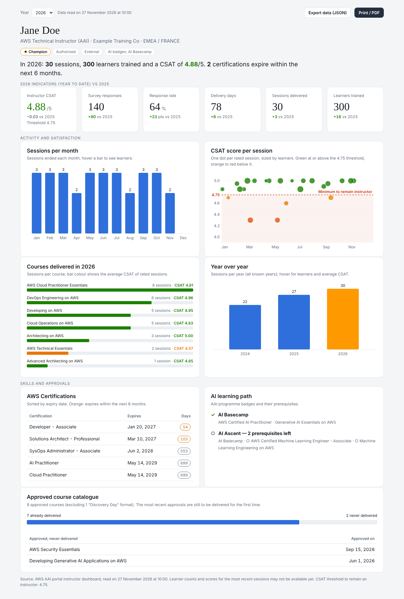
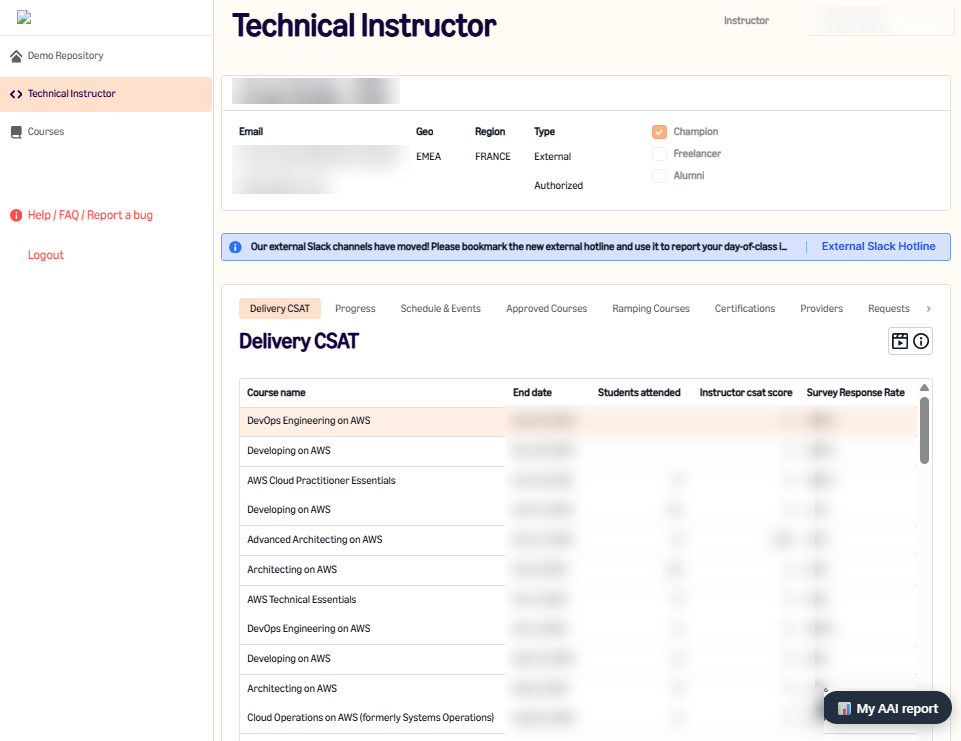
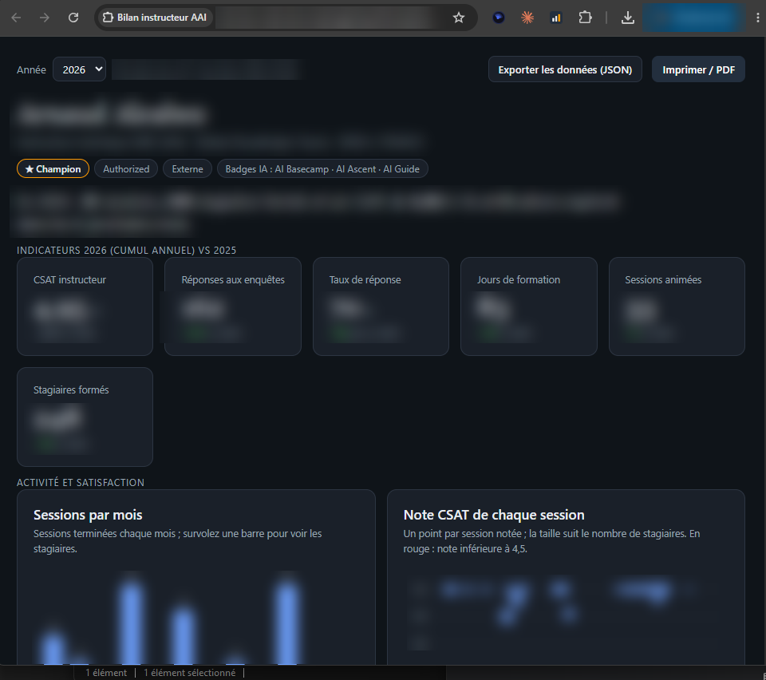

# AAI Instructor Report

A Chrome extension that turns the **AWS AAI portal instructor dashboard** into a one-page visual report, in one click.

The instructor opens their *Technical Instructor* page on the AAI portal and clicks **📊 My AAI report**. The extension reads their own dashboard tabs (CSAT, progress, approved courses, certifications, providers) and opens a report in a new tab. Everything happens in the instructor's browser. Nothing is sent anywhere.



*Preview generated from fictional data (`tests/preview/sample-data.js`).*

### On the portal

The **📊 My AAI report** button is added at the bottom right of the portal's *Technical Instructor* page. Personal data is blurred.



### In real use

Version 1.0 (French interface) running in Chrome with real portal data, dark mode. Personal data is blurred.



## What the report shows

| Section | Content |
|---|---|
| Header | Name, provider, geo/region, statuses (Champion, Authorized…), completed AI badges, one-sentence summary |
| Indicators | Official CSAT, survey responses, response rate and delivery days (year to date vs previous year), sessions and learners |
| Sessions per month | Number of sessions ended each month of the selected year |
| CSAT per session | One dot per rated session, with the **4.75 threshold** to remain an instructor |
| Courses delivered | Sessions per course, coloured by average CSAT |
| Year over year | Sessions per year across all known years |
| Certifications | Expiry dates, highlighted when they expire within 6 months |
| AI learning path | AAI badges and remaining prerequisites |
| Catalogue | Approved courses already delivered vs never delivered |

**CSAT colours:** green at 4.75 or above. Below 4.75 the colour goes from orange (just under) to red (4.0 or lower).

The report has a year selector, **Print / PDF** and **Export data (JSON)**.

## Quick start

**Windows:** download `AAI-Report-Installer-vX.Y.Z.zip` from the [Releases](../../releases) page (or build it, see below), unzip it, run `Installer.bat`, then follow the three clicks it shows.

**Any OS (manual):**
1. Unzip `aai-instructor-report-extension-vX.Y.Z.zip` somewhere permanent.
2. Open `chrome://extensions`, turn on **Developer mode**.
3. Click **Load unpacked** and select the `aai-bilan` folder.

Then reload your *Technical Instructor* page on the portal and click **📊 My AAI report** at the bottom right.

Full instructions: [docs/installation.md](docs/installation.md).

## Documentation

- [Installation](docs/installation.md): Windows installer, manual install, updates, uninstall, corporate deployment
- [Usage](docs/usage.md): generating, reading and sharing the report
- [Architecture](docs/architecture.md): components, data flow, how the portal is read
- [Data model](docs/data-model.md): the JSON stored and exported by the extension
- [Maintenance](docs/maintenance.md): what to change when the portal changes, thresholds, releasing
- [Privacy and security](docs/privacy.md): permissions, what is read and where it is stored

## Repository layout

```
extension/            Chrome extension (Manifest V3), loaded as-is by Chrome
  manifest.json
  content.js          reads the portal page, injects the button
  content.css         button style
  background.js       service worker: stores data, opens the report
  dashboard.html/.css/.js   the report page
  d3.min.js           D3 v7 (bundled, no CDN)
  icons/
installer/windows/    Installer.bat + installer.ps1 + README.txt
scripts/build.sh      builds the zips into dist/
tests/preview/        renders the report from fictional data (no portal needed)
docs/                 documentation and screenshots
```

## Development

```bash
# Preview the report with fictional data and check for page errors
pip install playwright && playwright install chromium
python3 tests/preview/make_sample.py
python3 tests/preview/render.py            # screenshots in tests/preview/out/

# Build the distributable zips into dist/
scripts/build.sh
```

To test against the real portal, load `extension/` with **Load unpacked**, then after each change click **Reload** on the extension card and reload the portal page.

## Limits

- Official yearly indicators come from the portal's *Progress* tab, which covers only the current and previous year. Older years show the average of session scores.
- Learner counts and scores for the most recent sessions may not yet be in the portal.
- The extension depends on the portal's current layout. If AWS changes it, the report still opens and names the tab it could not read (see [Maintenance](docs/maintenance.md)).

This project is not affiliated with or endorsed by Amazon Web Services.
